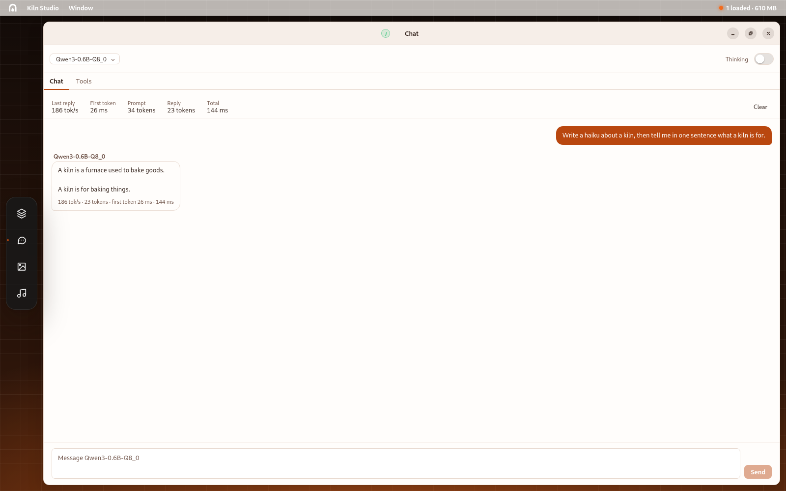

# Kiln Studio

Try models with Kiln: chat with a GGUF model and watch the tokens per second,
watch it call tools, make an image, a song or a video clip, ask a vision model about a picture, and see what is loaded
and how much memory it holds. Kiln
runs the engines (llama.cpp, stable-diffusion.cpp, acestep.cpp, yue2.cpp) inside one JVM, through Java's FFM API; Kiln Studio is the
desktop app around it, the sibling of [Drivine Studio](https://github.com/liberation-data/drivine-studio) and built the
same way: Next.js and Electron, on the [desk](https://www.npmjs.com/package/@liberation-data/desk).



## Windows

- **Models**: what in the Hugging Face cache Kiln can run (every GGUF chat model, and the image, song, video and vision
  presets whose files are all there), which are loaded in Kiln's `ModelPool`, the memory they hold against its budget, and the GPU's
  own memory use. Load and unload from here.
- **Chat**: a conversation streamed token by token, with tokens per second, time to the first token and token counts.
  **Thinking** shows Qwen3's reasoning (off sends Qwen3's `/no_think`). **Tools** offers the model a clock and a
  calculator through `LlamaModel.chatJson`: each call it makes is run by the backend and its answer handed back.
- **Image**: a prompt, size, steps, guidance and seed in; the image out, with the steps as they go and their timings.
- **Song**: a style, lyrics, length, BPM and key in; a 48 kHz song out, played in the window, with the time it took and
  the request as the engine resolved it. Two engines: ACE-Step 1.5, and YuE2 (style, lyrics and length only; it also
  shows the ABC score it composes first). YuE2's weights are CC BY-NC 4.0, no commercial use, which the window says
  when it is chosen.
- **Video**: LTX-2.5 through stable-diffusion.cpp: a prompt, an optional first frame, size, frames, fps, and sound on or
  off in; an .mp4 out, played in the window. Two-stage (the default) is Kiln's VideoClip recipe: a draft, the x2 latent
  upscaler, a refine at twice the size. Progress shows each stage's steps. A clip takes minutes, and stable-diffusion.cpp
  can't be stopped mid-render: Stop waiting leaves the backend to finish it. Needs `ffmpeg` (on the `PATH`, in
  `/opt/homebrew/bin` or `/usr/local/bin`, or `KILN_STUDIO_FFMPEG`) to make the .mp4.
- **Inspect**: an image (dropped on, chosen, or one of the samples) and a prompt in; a vision model's answer out,
  streamed with tokens per second, as free text or as JSON held to a schema (`LlamaModel.chatJson` with images, through
  llama.cpp's mtmd). Three models: Qwen3-VL 4B (the default), PaddleOCR-VL 1.6 and MedGemma 1.5 4B. Three presets fill
  the prompt and schema: **Read an invoice** (vendor, number, date, line items and totals, shown as JSON and as tables),
  **Find defects** (boxes as JSON, drawn over the image) and **Describe for review** (free text, with MedGemma: an aid
  for a clinician's review, not a diagnosis). PaddleOCR-VL takes task prompts (`OCR:`); given a schema, it reads the
  text and Qwen3-VL fills the schema from it. The samples are in `public/samples` (see its `NOTICE.md`): the invoice and
  the tray are drawn by `scripts/DrawSamples.java`, with made-up data; the chest X-ray is CC0, from Wikimedia Commons.
  MedGemma's weights are under Google's Health AI Developer Foundations terms, which the window says when it is chosen.

## How it fits together

```
Electron (main.cjs)
 ├─ starts Kiln's backend:  java -jar server/kiln-studio-server.jar   (127.0.0.1:5191, KILN_STUDIO_PORT)
 ├─ starts the studio's Next.js server in Electron's own Node        (localhost:5190, PORT)
 └─ opens a window on it
page ──/api/*──▶ Next.js (src/app/api/[...path]) ──▶ kiln-studio-server ──FFM──▶ llama.cpp · stable-diffusion.cpp · acestep.cpp · yue2.cpp
```

The backend is `kiln-studio-server`, a module of the Kiln repository: JDK-only HTTP (`com.sun.net.httpserver`), replies
streamed as server-sent events, models kept in Kiln's `ModelPool`. The page talks only to the studio's own server, which
passes `/api/*` on as it is, so the browser app works the same from `npm start`. The backend is told the app's pid and
exits with it, so a model never stays on the GPU after the app has gone.

## Running it

Needs Node 22+, Java 25, and Kiln's native libraries (`native/build.sh` in the Kiln checkout).

```sh
npm install
npm run server:build   # builds kiln-studio-server in KILN_HOME (default ../kiln) into server/, with the native libraries
npm run server:jre     # optional: a Java runtime for the app of its own, in server/jre (what a release ships)
npm run electron       # builds the page, then starts the app (and with it, the backend)
```

In development, each part on its own:

```sh
npm run server         # the backend on 5191
npm run dev            # the page on http://localhost:5190, with hot reload
npm run electron:dev   # the app on the dev server (uses the backend already running)
```

Settings, from the environment:

| Variable | |
|---|---|
| `HF_HUB_CACHE` / `HF_HOME` | where the models are (default `~/.cache/huggingface/hub`) |
| `KILN_STUDIO_STUB` | kinds of work answered by a stub that loads nothing, as `image,song,video` (or `chat`, `vision`): for trying the app without the GPU |
| `KILN_STUDIO_FFMPEG` | the ffmpeg that makes a video's .mp4 (else the `PATH`'s) |
| `GGML_VK_MAX_NODES_PER_SUBMIT` | Vulkan only: 8 unless set, so an LTX decode stays under amdgpu's compute timeout |
| `KILN_STUDIO_BUDGET_GB` | the pool's memory budget (24) |
| `KILN_STUDIO_IDLE_MINUTES` | unload a model idle this long (15) |
| `KILN_STUDIO_HOME` | where images, songs and videos are kept (`~/.kiln-studio`, in `outputs/`) |
| `KILN_HOME`, `KILN_NATIVE`, `KILN_BACKEND` | for `npm run server:build`: the Kiln checkout, and which native libraries to ship |
| `KILN_STUDIO_JAR`, `KILN_LIBRARY_PATH`, `KILN_STUDIO_JAVA` | to run another backend jar, libraries or Java |
| `PORT`, `KILN_STUDIO_PORT` | the page's and the backend's ports (5190, 5191) |

`npm run package:linux` packs the app with electron-builder, with the backend jar, the native libraries and, after
`npm run server:jre`, a Java runtime as resources (in `server/`). `server:jre` jlinks one from the JDK at `JAVA_HOME`
with only the modules the jar uses (about 60 MB); the app runs it, `server/jre/bin/java`, and without it
`$JAVA_HOME/bin/java`, or `java` on the `PATH`.

## Releases

GitHub Actions builds what a release ships, from the Kiln commit in `kiln.ref` (bump it to take a newer Kiln):

- `kiln-backend.yml`, called by the two below once per platform: checks out Kiln, builds the engines the studio runs
  (`native/build.sh vulkan|metal llama sd acestep yue2`, cached), the backend jar and its jlink'd Java runtime, and
  checks that all four libraries are there and that the backend starts on it.
- `linux-build.yml`: a `.deb` and an `.rpm`, x64, Vulkan. They depend on the Vulkan loader, a Vulkan driver (Mesa's,
  unless NVIDIA's is already there) and OpenMP, so `dnf` or `apt` installs whatever is missing.
- `macos-signed.yml`: a `.dmg` and a `.zip` for Apple silicon and for Intel, Metal, signed with a Developer ID and
  notarized, in the `apple-signing` environment.

By hand (Actions, Run workflow) they keep what they built as the run's artifacts; on a published release (a `v*` tag)
they attach it to the release. Models are never bundled: the app finds them in the Hugging Face cache.

The workflows read the private Kiln repository with a deploy key: a read-only deploy key on `liberation-data/kiln`,
its private half in this repository's `KILN_DEPLOY_KEY` secret.

## Tests

```sh
npm test                                   # the page's helpers, the proxy, and how the app starts the backend
./gradlew :kiln-studio-server:test         # in the Kiln checkout: every route, over HTTP, with the engines stubbed
```

## License

Apache 2.0.
